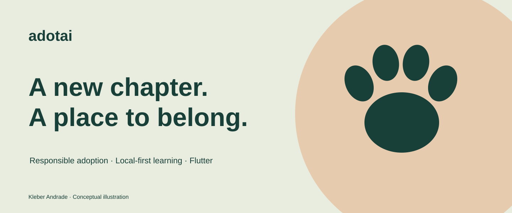
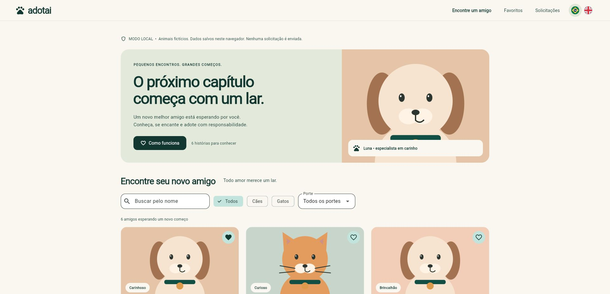

# Adotai



[](https://github.com/kleberandrade/adotai-flutter/actions/workflows/flutter.yml)
[](https://docs.flutter.dev/release/release-notes)
[](pubspec.yaml)
[](LICENSE)

A pet-adoption learning app by **Kleber Andrade**. Meet six fictional animals, combine filters, save favorites and follow a simulated adoption from request to meeting to completion. The local workflow runs without accounts, Firebase credentials or a backend.

**Local mode is always visible. No application is sent to a person, shelter or organization.** Use fictional details such as `Ana Teste` and `ana@example.test`.

## Run it

Validated with **Flutter 3.50.0, Dart 3.14.0**. The manifest requires Flutter >=3.50.0 and Dart >=3.14.0 <4.0.0. Keep the committed lockfile for reproducibility.

```sh
git clone https://github.com/kleberandrade/adotai-flutter.git
cd adotai-flutter
# Optional isolated SDK; this does not update your shared Flutter installation.
git clone --depth 1 --branch 3.50.0 https://github.com/flutter/flutter.git .tooling/flutter
export PATH="$PWD/.tooling/flutter/bin:$PATH"
flutter --version
flutter pub get --enforce-lockfile
flutter run -d chrome --web-port=18769
```

For a release build with bundled rendering resources:

```sh
flutter build web --release --no-web-resources-cdn
python3 -m http.server 18769 --bind 127.0.0.1 --directory build/web
```

Open [the local app](http://127.0.0.1:18769). Building downloads SDK/package artifacts. The resulting app uses local illustrations and bundled engine resources, with no Firebase calls or remote pet photos. This is a static Web build; no offline installation or service-worker guarantee is made. Deployment is a separate action and has not been performed.

## What to try

1. Filter **Cats** and **Small**, or search `Luna`. Species, size and name filters combine. The clear empty state appears when nothing matches.
2. Save Luna with the heart button. Open **Favorites**, switch PT-BR/EN and reload: the saved pet and language remain.
3. Open Luna's profile and apply with fictional details. Name requires 2 trimmed characters, email a basic valid format, and the home description 20 characters. Confirm the responsible-adoption commitment.
4. Open **Requests** and simulate a meeting, then completion. Cancel an active request to try again. Duplicate active or completed requests are rejected.

The circular Brazil/UK flags are drawn locally, have language tooltips, accessible labels and touch targets. Language changes retain favorites and applications. The application form closes before navigation to tracking; validation and save failures keep the form available.

## Current screenshots

Actual Chrome captures of the running implementation, not design mockups. Captured on 2026-11-17, with synthetic local data.



[Phone catalog, 390 × 844](docs/screenshots/mobile.jpg) · [Phone request tracking in English](docs/screenshots/requests.jpg)

## Architecture

- `lib/modules/pets/pets_model.dart`: immutable pet/request values, six synthetic records, combined filters and shared application validation. Original species, name, size, gender, age and temperament responsibilities remain in the pets domain. Unverified health details are explicitly unknown.
- `pets_repository.dart`: the replaceable `PetsRepository` contract, versioned state and local adoption rules. Saves commit in-memory state only after storage succeeds.
- `preferences_store.dart`: `StateStore` adapter using **SharedPreferencesAsync 2.5.6**, storing one JSON document under `adotai.local.v1`.
- `pets_page.dart`: responsive Material UI 1.11.1 presentation, explicit loading/error/empty states, bilingual copy, profiles, forms and tracking.
- `pet_portrait.dart`: original vector-style animal portraits and circular flags, painted locally. The historical project PNG assets remain credited to the original project and supply the app icon.

The UI is the single repository writer and disables mutations while saving. `PetsRepository` can be replaced at `main.dart`; a backend implementation must supply remote catalog loading, authentication/authorization, server-side validation, idempotency and transactional state transitions. There is **no Firebase adapter, emulator setup, fake sign-in or production service** in this revision.

```dart
final repository = LocalPetsRepository(PreferencesStore());
await repository.load();
await repository.toggleFavorite('luna');
await repository.apply(
  'luna', 'Ana Teste', 'ana@example.test',
  'A safe home with daily walks and veterinary care.',
);
await repository.transition('luna', AdoptionStatus.meeting);
```

Transitions: `submitted → meeting → completed`; `submitted` or `meeting → cancelled`. Terminal states cannot advance. Reapplying after cancellation replaces that pet's cancelled request; this is a current-state demo, not an immutable audit log.

## Persistence, privacy and recovery

Favorites, language and applications persist in **this browser origin** using local storage through the preferences plugin. There is no sync, encryption or backup. Changing host/port/browser, private mode, clearing site data or browser eviction may remove or separate data. Preferences are suitable for this learning workflow, not critical production adoption records. Two tabs writing simultaneously are not coordinated.

Storage errors leave the previous committed state intact and show a retryable error. Invalid or incompatible saved JSON is preserved and produces a load error with Retry. Check browser storage permissions first. If you intentionally want to reset disposable test data, clear this site's storage in your browser; this erases local favorites and requests. No automatic destructive reset runs.

## Validation and compatibility

```sh
dart format --output=none --set-exit-if-changed lib test
flutter analyze
flutter test
flutter build web --release --no-web-resources-cdn
```

Run the checks sequentially. See [the validation record](docs/VALIDATION.md) for outcomes, browser checks and dependency limits. CI repeats formatting, analysis, tests and the release Web build using Flutter 3.50.0. Its badge reports the actual workflow status.

Direct packages were updated to stable compatible versions. `material_color_utilities` and `test_api` remain pinned by Flutter; no incompatible overrides are used. `vector_math` was upgraded to 2.4.4. `flutter pub outdated` is the source for future dependency reviews.

**Verified target: Web.** Desktop and phone-sized Chrome were inspected; this is not an Android or iPhone device test. The historical `android/` and `ios/` host projects remain for reference and have not been migrated or built. They require current platform scaffolding/configuration before native use. No Android SDK licenses were accepted and no shared Flutter SDK was changed.

## Learning material and history

The original Firebase/MobX implementation is preserved in git history (last pre-modernization revision `58924a9`). Retired account, editor, helpers and generated MobX files were removed from the active source because their old APIs cannot run on the modern toolchain; no Firebase account/data migration is claimed.

A complete Portuguese lesson revision is in [docs/MEDIUM_LESSON_PT_BR.md](docs/MEDIUM_LESSON_PT_BR.md), including verified examples and exactly five practical exercises. No linked Medium lesson or editorial access was available; this is a prepared revision, **not a published article update**. No newsletters or messages were sent.

See [CONTRIBUTING](CONTRIBUTING.md), [CHANGELOG](CHANGELOG.md) and [the work log](docs/WORK_LOG.md).

## License and credits

Copyright © 2020–2026 **Kleber Andrade**. Source and new locally drawn illustrations are available under [MIT](LICENSE). Original project authorship/history and assets are retained. Flutter-generated files and dependencies retain their own license notices. No third-party pet photography is used.
