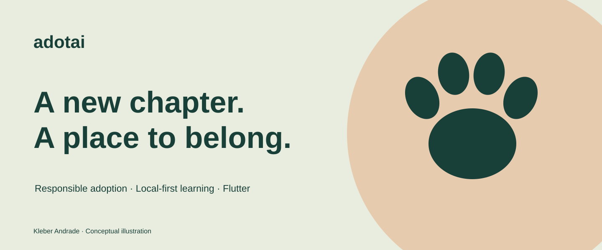
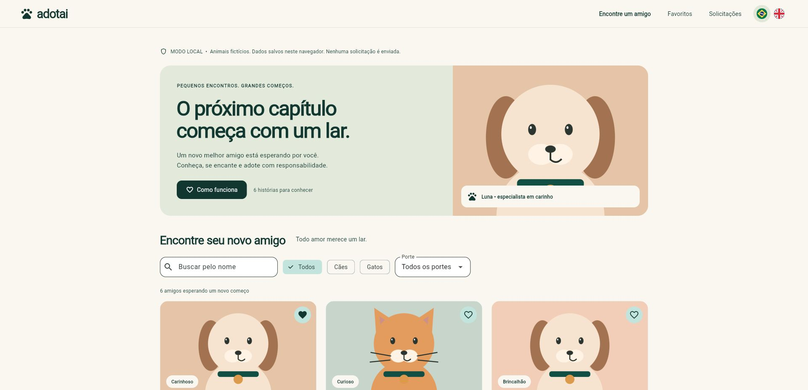
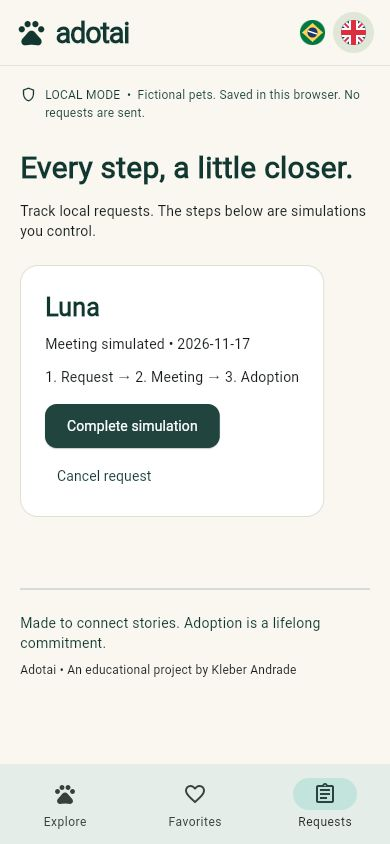
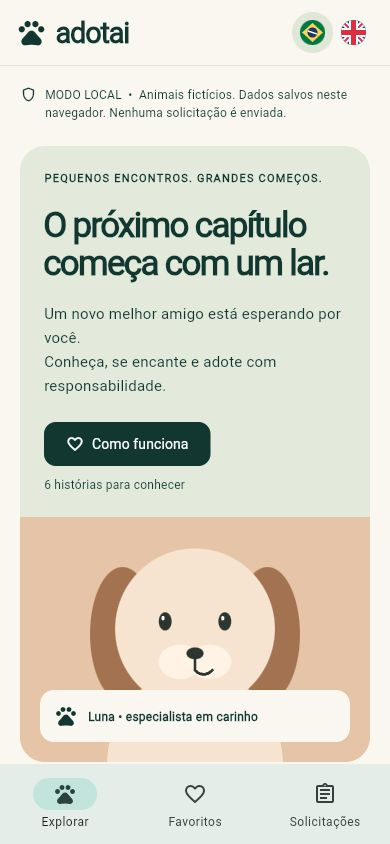

# Adotai com Flutter: um novo começo para cada amigo

**Autor: Kleber Andrade**

**Situação editorial:** revisão preparada em 17/11/2026. Não foi localizada uma URL de aula vinculada no repositório nem uma sessão editorial do Medium disponível. Este arquivo não foi publicado. Ao incorporar a revisão, preservar a URL, o idioma, a autoria e os créditos da aula original. Não enviar newsletter.



Um aplicativo de adoção precisa ajudar a conhecer o animal e explicar o que acontece depois de uma solicitação. Nesta versão do Adotai, vamos construir essa experiência sem depender de credenciais: seis animais fictícios, catálogo com filtros, favoritos persistentes e acompanhamento de uma adoção simulada.

O aviso **Modo local** acompanha toda a navegação. Não existe autenticação fictícia e nenhuma solicitação chega a pessoas ou organizações. Usaremos dados sintéticos, como `Ana Teste` e `ana@example.test`.

## 1. Preparar uma instalação reproduzível

A revisão foi validada com **Flutter 3.50.0 e Dart 3.14.0**. O projeto usa Material UI 1.11.1, Shared Preferences 2.5.6 e Flutter Lints 6.0.0. O arquivo `pubspec.lock` registra o conjunto resolvido. Dependências transitivas limitadas pelo SDK não devem receber overrides incompatíveis.

```sh
git clone https://github.com/kleberandrade/adotai-flutter.git
cd adotai-flutter
git clone --depth 1 --branch 3.50.0 https://github.com/flutter/flutter.git .tooling/flutter
export PATH="$PWD/.tooling/flutter/bin:$PATH"
flutter --version
flutter pub get --enforce-lockfile
flutter run -d chrome --web-port=18769
```

O SDK fica isolado dentro da pasta ignorada `.tooling`. Não é necessário atualizar um Flutter compartilhado ou aceitar licenças do Android para executar o alvo Web.



## 2. Começar pelo domínio dos animais

O módulo `lib/modules/pets` mantém o domínio do projeto original. O modelo moderno usa campos imutáveis: identificador, nome, espécie, porte, gênero, idade e temperamento. Os seis perfis são sintéticos e usam ilustrações desenhadas pelo próprio aplicativo.

O catálogo não inventa abrigo, endereço ou histórico clínico. Castração e vacinas precisam ser confirmadas em uma adoção real; o perfil deixa essa diferença explícita.

A função `filterPets` combina todos os critérios com uma conjunção lógica. O nome é comparado sem diferenciar maiúsculas e minúsculas e a busca ignora espaços nas extremidades:

```dart
final cats = filterPets(seedPets, species: 'cat', size: 'small');
final luna = filterPets(seedPets, query: ' LUNA ');
```

O primeiro exemplo retorna os três gatos do catálogo. O segundo retorna Luna. Nenhum resultado é um estado normal: a interface explica como tentar outros filtros ou salvar um favorito, sem apresentar uma tela vazia silenciosa.

## 3. Separar estado, repositório e armazenamento

`PetsRepository` define os comportamentos do aplicativo. `LocalPetsRepository` implementa as regras e `StateStore` define leitura e escrita. O adaptador `PreferencesStore` usa `SharedPreferencesAsync`, evitando o cache da API legada.

```dart
final repository = LocalPetsRepository(PreferencesStore());
await repository.load();
await repository.toggleFavorite('luna');
await repository.setLanguage('en');
```

O estado guarda favoritos, idioma e solicitações em um documento JSON versionado. Uma escrita termina antes de o novo estado se tornar visível. Se o armazenamento falhar, o estado anterior é mantido e a interface permite tentar a ação novamente.

Na leitura, dados inválidos, versão desconhecida ou referências a animais inexistentes produzem um erro recuperável. O aplicativo preserva os dados em vez de apagá-los silenciosamente. Verifique as permissões do navegador e use **Tentar novamente**. Limpar os dados do site é uma decisão explícita de descarte, pois elimina os registros locais.

Essa persistência pertence à origem do navegador: trocar a porta ou navegador cria outro espaço. Não há sincronização, criptografia ou backup. Shared Preferences serve à demonstração; registros críticos de uma adoção real precisam de armazenamento e controle de acesso adequados. Duas abas não coordenam gravações entre si.

## 4. Validar a intenção e acompanhar etapas

O formulário solicita um nome fictício com pelo menos dois caracteres, um e-mail com formato válido e uma descrição do lar com pelo menos vinte caracteres. A interface também pede a confirmação do compromisso com uma adoção responsável. As regras de conteúdo são verificadas no repositório, além da validação visual.

```dart
await repository.apply(
  'luna',
  'Ana Teste',
  'ana@example.test',
  'A safe home with daily walks and veterinary care.',
);
await repository.transition('luna', AdoptionStatus.meeting);
await repository.transition('luna', AdoptionStatus.completed);
```

As transições aceitas são `submitted → meeting → completed`. Uma solicitação em `submitted` ou `meeting` pode ser cancelada. Uma solicitação concluída não pode voltar ao início, e uma solicitação ativa impede outra para o mesmo animal. Após cancelamento, tentar novamente substitui o registro cancelado daquele animal. Não estamos construindo um histórico imutável de auditoria.



Os botões dizem **Simular encontro** e **Concluir simulação**. Não existe confirmação de abrigo ou comunicação real por trás dessas ações. Um backend futuro deve aplicar autorização, idempotência e as mesmas transições no servidor. As interfaces permitem substituir a implementação local; um adaptador Firebase e emuladores ainda não fazem parte desta entrega.

## 5. Cuidar da experiência em telas e idiomas diferentes

A interface tem navegação superior no desktop e inferior no celular. O catálogo passa de três colunas para uma, conforme o espaço disponível. Os campos têm rótulos, os ícones de favorito têm tooltips e os seletores de idioma têm bandeiras circulares locais, rótulos acessíveis e botões com área de toque adequada.

A troca entre português e inglês preserva favoritos e solicitações e persiste o idioma. Busca, filtros e aba atual são estados temporários da tela; não são prometidos como dados salvos.



As ilustrações são conceituais, não fotografias de animais disponíveis para adoção. As três imagens desta seção e das anteriores são capturas reais da implementação em execução, não mockups.

## 6. Verificar antes de publicar

Execute os comandos sequencialmente:

```sh
dart format --output=none --set-exit-if-changed lib test
flutter analyze
flutter test
flutter build web --release --no-web-resources-cdn
python3 -m http.server 18769 --bind 127.0.0.1 --directory build/web
```

Os testes cobrem filtros combinados, validação, persistência por recarga do repositório, duplicidade, transições, cancelamento, falha de escrita, dados inválidos, interface móvel, troca de idioma e formulário completo. A inspeção no Chrome também confirmou favorito e etapa da solicitação após recarregar a página.

O alvo verificado é Web. Uma viewport de celular não equivale a um teste em Android ou iPhone. As antigas pastas nativas são referências históricas e precisam de modernização própria antes de builds nativos. Não houve publicação em hospedagem, lojas ou serviços de backend.

## Material histórico, referências e créditos

A versão anterior com Dart 2.7, Firebase e MobX permanece no histórico Git, até a revisão `58924a9`. Ela explica a evolução do projeto, mas suas APIs antigas não são o caminho ativo desta aula. Não há migração automática de contas ou dados Firebase.

- Projeto e autoria: [Kleber Andrade — Adotai](https://github.com/kleberandrade/adotai-flutter).
- [Código dos modelos e regras](../lib/modules/pets/pets_model.dart), [repositório](../lib/modules/pets/pets_repository.dart) e [testes](../test/adoption_test.dart).
- [Notas oficiais do Flutter](https://docs.flutter.dev/release/release-notes).
- [Material UI oficial](https://pub.dev/packages/material_ui).
- [Shared Preferences: APIs e limites](https://pub.dev/packages/shared_preferences).
- [Contribuição](../CONTRIBUTING.md), [registro de validação](VALIDATION.md) e [licença MIT](../LICENSE).
- Capa e retratos: desenhos locais novos. Capturas: aplicativo real no Chrome. Assets históricos do projeto e créditos originais foram preservados; dependências e arquivos gerados mantêm suas próprias licenças.

## Exercícios práticos

1. **Combinar filtros.** Objetivo: comprovar que busca, espécie e porte se combinam. Conclusão: um teste encontra Pipoca com `dog` e `small`, outro retorna vazio para uma combinação incompatível, e um terceiro encontra Luna com espaços e caixa diferente.
2. **Tratar falhas sem perda de dados.** Objetivo: implementar um `StateStore` de teste que falha na gravação. Conclusão: o teste demonstra que um favorito previamente salvo permanece após uma nova ação falhar, e a interface exibe uma opção de nova tentativa.
3. **Ampliar a validação do lar.** Objetivo: acrescentar um limite de conteúdo consistente no formulário e no domínio. Conclusão: testes cobrem os valores imediatamente antes, no limite e depois do limite, com mensagens em português e inglês.
4. **Preparar um repositório remoto de teste.** Objetivo: criar uma implementação substituível de `PetsRepository` para um serviço local de desenvolvimento, sem credenciais de produção. Conclusão: testes demonstram falha de rede, repetição idempotente e bloqueio de transição inválida; a interface identifica claramente qual modo está ativo.
5. **Verificar acessibilidade e persistência.** Objetivo: percorrer o fluxo usando teclado e nos dois idiomas. Conclusão: registrar capturas em 390 × 844 e desktop, confirmar foco e rótulos, salvar um favorito e uma solicitação fictícia, recarregar e comprovar que ambos e o idioma foram preservados.
